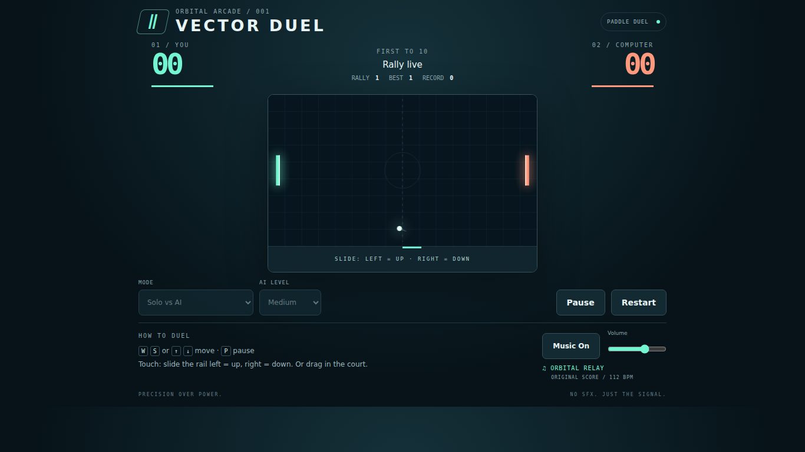

# Vector Duel — private preparation

[Older live deployment](https://nateofspades.github.io/pong_game/) — the legacy site, not this private branch or an approved new URL.



**Not published or cleared for release.** Existing geometric art, mechanics, Orbital Relay soundtrack and `vector-duel.record` / `vector-duel.music` storage remain intact. Proposed branding/URL is only in `docs/private-migration.md`. Gameplay screenshots were refreshed from actual private-worktree runs after the layout fix; historical test totals below are not new preparation passes. Current evidence is `/root/arcade-migration-audit/preparation/paddle-*`.

Local review: `npm ci`, `npm run serve`, open `http://127.0.0.1:4187`. Tests: `npm test`; stop the manual server, then `BASE_URL=http://127.0.0.1:4187 npm run test:browser` (Chromium, Firefox and WebKit, one worker). Linux audio tests require `pulseaudio`; the runner creates an isolated null sink, not physical-speaker verification. Browser install: `npx playwright install --with-deps chromium firefox webkit`. No build command exists. All servers/tests in this shared audit must use `flock /root/arcade-migration-audit/preparation/test.lock`. Candidate static runtime is only `index.html`, `style.css`, `src/`, `assets/icon.svg` and `LICENSE`; exclude tests/evidence/private docs.

A precision paddle duel in a quiet orbital arcade. Read the angle, catch the signal, and reach ten before your opponent. Original canvas visuals and an original retro-electronic score; no backend, accounts, advertising, paid services or SFX.

## Features

- Solo play against three deliberately fallible AI levels, or local two-player keyboard play.
- Fixed-step, frame-independent physics; contact-dependent returns, bounded bounce angles, rally acceleration capped at 820 units/second and collision substeps.
- Predictable 1.5-second serve countdown, pause/resume, restart and final-score victory / Game Over.
- Current rally, persistent longest rally and highest match score. Storage is optional; denied storage never prevents play.
- Responsive 16:9 court, high-DPI canvas, portrait and compact landscape layouts, pointer capture and an obstruction-free touch rail.

## Controls and play

Start a match, keep the ball in play, and score when your opponent misses. First to 10 wins. Hit near a paddle edge for a steeper return.

| Mode | Controls |
| --- | --- |
| Solo desktop | W / S or Up / Down arrows |
| Two players | Player 1: W / S; Player 2: Up / Down arrows |
| Solo touch | Drag vertically in the court, or slide the rail below it: left = up, right = down. The rail keeps your finger clear of the ball. |
| Match | P or Pause/Resume button; Restart starts a fresh score |

Two-player mode requires a keyboard; dual-touch multiplayer is not implemented. Choose mode/difficulty before a match or after it ends. Moving away from the page automatically pauses gameplay; it never auto-unpauses. Resize/orientation preserves the match. Compact small-phone layouts keep music and match controls visible while omitting secondary decorative instructions; the drag rail keeps its visible direction guide. Browser zoom remains available outside the game controls.

## Music

“Orbital Relay”: original F-minor instrumental at 112 BPM, with swung pulse bass, clipped pentatonic motif, evolving airy harmony and pitched metrical rhythm. Score and synthesis: [src/music.js](src/music.js). Original code, visual assets and music are [MIT licensed](LICENSE). [Provenance and source comparisons](docs/music-provenance.md).

Music unlocks on interaction. One persistent AudioContext and one looping source continue through Start, Restart, pause/resume, victory, menus and orientation changes. Music On/Off ramps the master gain without resetting phase; volume and enabled preferences persist. Background audio may suspend and resumes at the same transport phase when the browser permits it. No gameplay sound effects exist.

## Run locally

Use Node.js 22 or newer. No bundler or production dependencies.

```sh
npm ci
npm run serve
```

Open http://127.0.0.1:4187/ . For reproducible installs use `npm ci`.

```sh
npm test
npx playwright install --with-deps chromium firefox webkit
# Linux headless audio tests also need: sudo apt-get install -y pulseaudio
npm run test:browser
```

Vitest covers deterministic rules and audio abstraction. Playwright runs Chromium, Firefox and WebKit with one worker, six viewport geometries, real startup/keyboard/touch, end states, persistence and real Web Audio measurements. Firefox does not support Playwright mobile emulation; its touch-context test is skipped. Native CDP drag injection is Chromium-only and skipped in Firefox/WebKit; both Chromium and WebKit have real mobile touch-context taps. On Linux the test runner starts and cleans up its own PulseAudio null sink for a reliable Firefox audio clock, without modifying a shared audio service. Test scenarios are exposed only on localhost with `?test`; deployed gameplay has no mutating debug hook. Read-only state/audio snapshots are available at `window.vectorDuel`.

## Technology, verification and credits

Static HTML/CSS, vanilla ES modules, Canvas 2D, Web Audio, localStorage, Vitest and Playwright. The existing legacy workflow targets main and pull requests; it was not run or changed for this private preparation. Do not publish this branch or its private documents. Product references remain relative; future deployment requires separate authorization and direct verification.

See [verification evidence](docs/verification.md) for actual counts and limitations. Automated mobile emulation is not physical-device touch or subjective audio testing. Target is smooth 60 FPS, not a hardware-independent performance guarantee.

The existing [MIT notice](LICENSE) credits **Nathan Burns (2026)**. The geometric art and **Orbital Relay** score/synthesis remain the original project implementation, not newly licensed third-party content. These records are not independent chain-of-title clearance. Vitest, Playwright and Prettier are development/test tooling only; no `node_modules`, browser binaries, test fixtures or private migration documents belong in a future runtime artifact.
